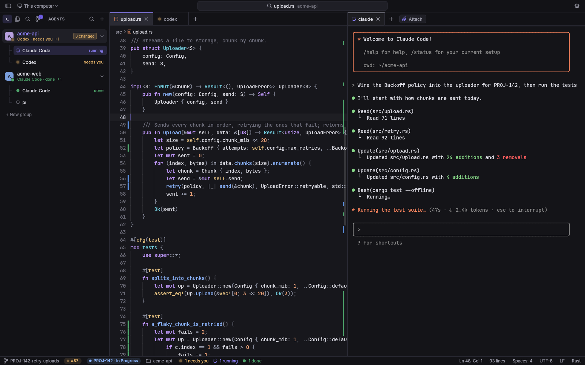
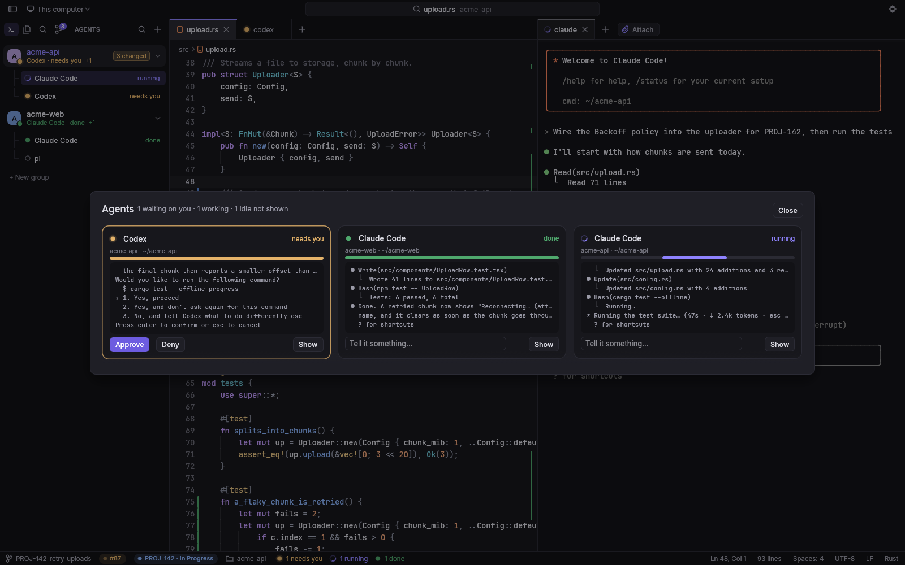
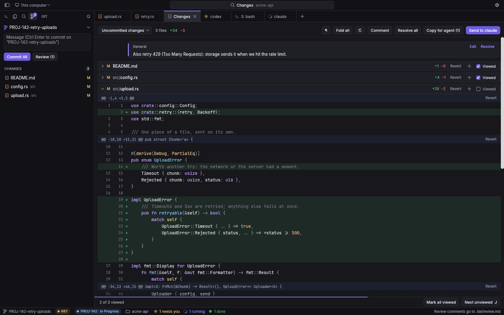
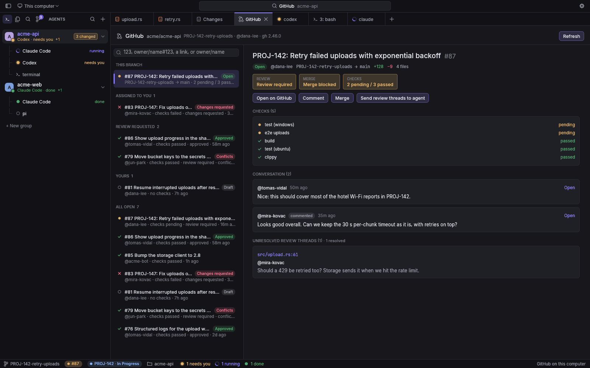
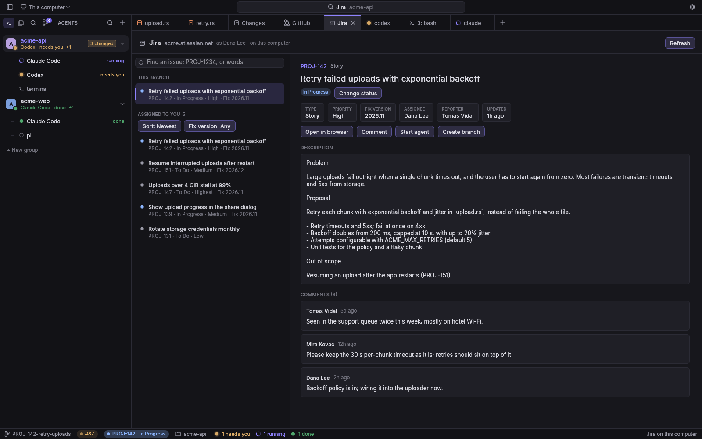
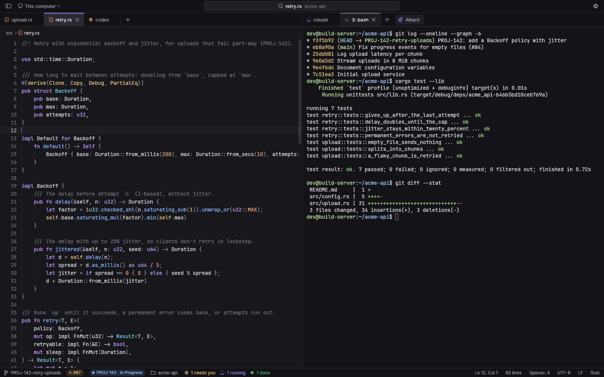
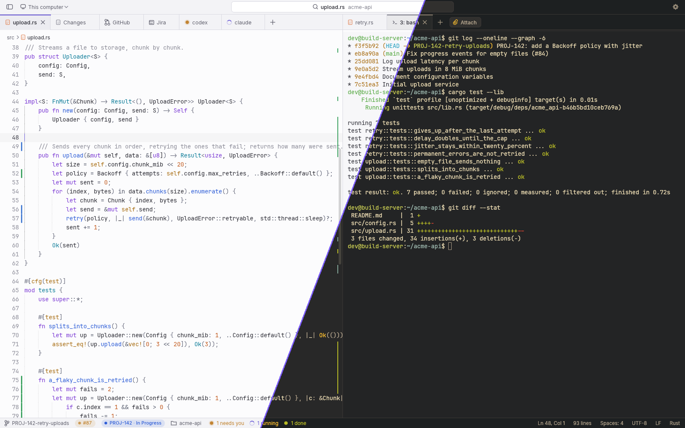

# Ilai

**A fast agent IDE.** Run coding agents on your Linux servers over SSH, watch them all from one window,
answer them when they ask, review what they changed and ship it.

| | Download | |
|---|---|---|
| **Windows** | **[Ilai-Setup.exe](https://github.com/praveen-manick/ilai-releases/releases/latest/download/Ilai-Setup.exe)** | Windows 10 (1809 or newer) or 11, 64-bit |
| **Android** | **[Ilai-Android.apk](https://github.com/praveen-manick/ilai-releases/releases/latest/download/Ilai-Android.apk)** | The phone app: your agents and servers in your pocket |
| **Handbook** | **[Ilai-Handbook.pdf](https://github.com/praveen-manick/ilai-releases/releases/latest/download/Ilai-Handbook.pdf)** | Every feature, step by step |

Both apps look for updates by themselves and tell you when one is out. [All releases](https://github.com/praveen-manick/ilai-releases/releases)

## What it does

- **Agents, all in view.** Claude Code, Codex, pi and other agents run in terminals on your server, inside
  [herdr](https://herdr.dev), so they keep working when you close the laptop or the network drops. The sidebar and
  the dashboard (`Ctrl Shift D`) show which one is working, which is done and which needs you; answer it right there.
- **Review, then ship.** The Changes tab shows what an agent changed, file by file. Comment on a line and send the
  comments back to the agent. Restore points let you undo an agent's whole run.
- **GitHub and Jira built in.** Your branch's pull request with its checks and reviews, every open pull request with
  how it stands, and your Jira issues. Start an agent on an issue or on failing checks in one click.
- **A real editor and terminals.** Syntax colours, search across files, Git, a file explorer, split columns, and
  terminals with your shell. Attach images and files to an agent from your PC.
- **A browser for agents.** On Windows, a browser inside Ilai that agents on the server drive: they test pages
  with it, and hand sign-ins to you.
- **Fast.** Native and drawn on the GPU: no Electron, no webview. One small program that opens in a blink and uses no
  CPU when idle. 37 themes.

## Safe by design

- Everything between your PC and your server goes over **SSH**. Nothing listens on the network.
- Passwords and keys are kept in Windows' own credential vault. GitHub and Jira sign-ins stay on the server; Ilai on
  your PC never holds their tokens.
- Updates are checked against the release's published digest before they install.

## Screenshots

| | |
|---|---|
|  |  |
| **Agent dashboard:** answer an agent without leaving your work | **Changes:** review, comment, send to the agent |
|  |  |
| **GitHub:** checks, reviews and every open pull request | **Jira:** your issues, and an agent on one in a click |
|  |  |
| **Editor and terminals** side by side | **37 themes**, light and dark |

## Install

1. Download **[Ilai-Setup.exe](https://github.com/praveen-manick/ilai-releases/releases/latest/download/Ilai-Setup.exe)**
   and double-click it.
2. Windows may say *Windows protected your PC*, because the installer is not signed yet. Click **More info**, then
   **Run anyway**.
3. Start Ilai from the Start menu. Click the host button at the top left, then **New SSH Connection…**, to reach your
   server. Ilai sets up what it needs there by itself.

To uninstall: **Settings → Apps → Ilai → Uninstall**.

### The phone app (Android)

1. On the phone, open **[Ilai-Android.apk](https://github.com/praveen-manick/ilai-releases/releases/latest/download/Ilai-Android.apk)**.
2. Allow your browser to install apps when Android asks, then tap **Install**.
3. Add a server (host, user, and a password or key): it shows your agents, their terminals and what they changed,
   and tells you when one needs you. A new build installs over the old one and keeps your servers.

The [handbook](https://github.com/praveen-manick/ilai-releases/releases/latest/download/Ilai-Handbook.pdf) covers
every feature step by step, with all the keyboard shortcuts.

## Feedback

Found a bug or want something? [Open an issue](https://github.com/praveen-manick/ilai-releases/issues).
